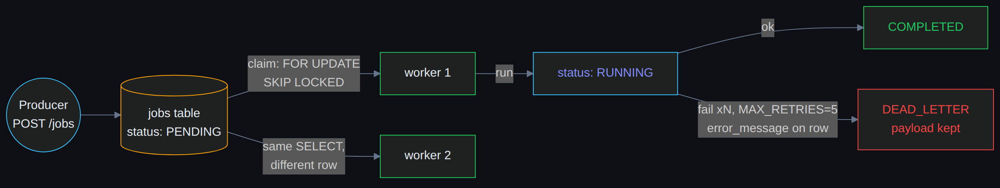

# job-queue

**A PostgreSQL-backed async task queue with no Redis dependency.** Built from scratch to understand what a queue actually is — push/pop/retry semantics, competing consumers, dead-letter handling — rather than installing a broker and treating the interesting part as magic.

## Why no Redis

Every production system I had seen treated Redis as "the thing that makes queues work." But a queue is not a network service — it's a pattern: a table with a status column, an atomic claim, and a retry policy. Postgres gives you all three with `SELECT ... FOR UPDATE SKIP LOCKED`, and you keep your data in one ACID place. The wave toward Postgres-native AI stacks (pgvector, pgvectorscale, pgai) pushed the same question: *how much of your infrastructure is just Postgres if you let it be?*

## How it works



```
Producer ──POST /jobs──▶ jobs table (status: PENDING)
                              │
        worker loop ──────────┘
        SELECT ... WHERE status='PENDING'
        FOR UPDATE SKIP LOCKED   ← atomic claim; competing workers never collide
                              │
                  status: RUNNING → run → COMPLETED
                              │
                   failure? retry_count += 1
                   ≥ MAX_RETRIES → DEAD_LETTER (kept for inspection, not silently dropped)
```

- **Claim:** `WITH FOR UPDATE SKIP LOCKED` — two workers polling the same table never grab the same row; no advisory locks, no external coordinator.
- **Retry:** bounded (`MAX_RETRIES = 5`), each failure records the error message on the row.
- **Dead-letter:** poisoned jobs are quarantined with full payload + error, not deleted.
- **Observability:** `structlog` structured logs with a request-ID middleware — every job event is grep-able JSON, not prose.

## Layout

```
app/main.py        FastAPI: create / list / inspect / delete jobs
services/          business logic, thin
worker/worker.py   the loop: claim → run → retry → dead-letter
models/, schemas/  SQLAlchemy model + Pydantic boundary
core/              config, logging, request-ID middleware
alembic/           schema migrations
```

## Run it

```bash
docker run -d -p 5432:5432 -e POSTGRES_PASSWORD=postgres postgres:16
alembic upgrade head
uvicorn app.main:app --reload     # API
python -m worker.worker           # worker (run N of these for competing consumers)
```

```bash
curl -X POST localhost:8000/jobs/ -H 'Content-Type: application/json' \
  -d '{"payload": {"action": "send_email", "email": "you@example.com"}}'
```

## What "done" means here

This is Stage 1 of a structured backend path: **auth service → job queue → append-only event log.** Done means: the semantics are correct and I can defend every line, not that it's Celery. Postmortems for all three stages live in the parent repo.

The next question this project raised — and couldn't answer — is event sourcing: *what if the log, not the table, is the source of truth?* That's the event-log project.

## License

MIT.